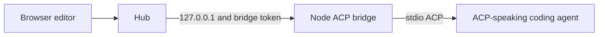

An ACP-speaking coding agent and a local model CLI can propose work. Neither one approves it. The notes below are the short form. The linked documents are the contracts.

The Hub-routed workspace ACP transport is a Conduit extension. Records carry `valueTier: "CONDUIT_NATIVE"`, registered as `workspace.GovernedACPBridge` in [conduit-inventions.json](https://github.com/jonathanagustin/conduit/blob/main/docs/evidence/conduit-inventions.json).

## Request path

The browser editor does not talk to the agent. `web/src/api/workspace-acp.ts` posts ACP JSON-RPC 2.0 to the Hub at `POST /v1/dev-workspaces/{workspaceID}/acp`, with same-origin credentials. `internal/workspaceacp/httpapi` authenticates the caller. The service in `internal/workspaceacp/application` binds the session and forwards the turn to a Node process. That process listens on `127.0.0.1` (`web/src/server/main.ts`) and speaks ACP to the agent on stdio (`web/src/server/agent.ts`). A prompt returns to the browser as a Hub server-sent event stream. The bridge port is not a browser route.

The bridge runs only when `DEVWORKSPACE_ACP_BRIDGE=node`. With that unset, an authorized initialize reports that the workspace ACP bridge is not configured. An unknown or unusable agent setting does the same, and logs the reason. It does not start a simulated agent. The in-memory bridge in `internal/workspaceacp/adapters/memorybridge` is a test double for the same port. It is not a live agent.

## Protocol, loopback, and token

The pinned ACP protocol version is `1`. `internal/workspaceacp/domain` rejects any other `protocolVersion` on initialize, and `web/src/api/protocol.ts` pins the same constant. The Node bridge checks it again against the ACP SDK constant before a session exists.

`internal/workspaceacp/adapters/nodebridge` starts the Node process with `CONDUIT_BRIDGE_REQUIRE_TOKEN=1` and a random 256-bit `CONDUIT_BRIDGE_TOKEN`, on port `0` so the listen port is ephemeral. Each Hub request to `http://127.0.0.1:{port}/acp` sends `X-Conduit-Bridge-Token` and the workspace owner, id, and branch. `verifyHubCaller` in `web/src/server/http.ts` rejects a request that carries `Origin`, `Sec-Fetch-Site`, or `Sec-Fetch-Dest` with 403, compares the token in constant time (401 on mismatch), and requires the three scope headers to match the process (403 on mismatch).

`INITIAL_AGENT_MODE=agent-full-access` is refused. A tool approval is not deployment authority.

## Identity and one session binding

Workspace ACP routes authenticate through the Hub operator resolver. When an OIDC resolver is configured, that resolver checks the token (`internal/controlplane/oidc_identity.go`). Insecure identity headers are a separate opt-in and are not this route's authority. A service account is refused.

A session binds to one owner and one branch. The branch must be `workspace/<owner>/<workspaceID>` or a path under that prefix (`domain.ResolveBranch`). The owner must be the workspace owner. A prompt, config change, cancel, close, or permission settlement on another owner, workspace, or branch is denied and audited.

## Permission classes

The Hub classifies each permission. An agent or bridge label cannot lower that class: `StricterRisk` keeps `high_change_request` if either side says so. Standing `allow_always` options are removed when `allow_once` is present, and otherwise rewritten as `allow_once`. Settlement accepts only an `allow_once` option.

| Class | What it covers | What must happen |
| --- | --- | --- |
| `low_confirm` | Ordinary in-workspace reads, edits, and local commands that the classifier does not treat as high risk | Stays `PENDING_CONFIRM` until the workspace owner confirms. Deny, reject, and cancel refuse the operation. |
| `high_change_request` | Deploy or publish kinds, absolute paths, paths the classifier treats as workflow, deploy, or credential material, and commands it treats as network or mutating infrastructure | Opens a change request through `ProposeHumanChange` and stays `PENDING_CHANGE_REQUEST`. Owner confirm is a conflict while that request is pending, forbidden if it was rejected or cancelled, and forbidden when no separate human has approved it. |

A completed `fs/write_text_file` is committed with `ApplyGovernedEdit`, which advances the proposal revision and clears any prior approval id and validation outcome. The edit does not approve or deploy the workspace.

## Audit receipts and mirrored events

Session open and close, permission request and decision, tool call, file write, and command each append an authorization audit event. The event carries `sessionId`, `runId`, and `threadId`, plus workspace, branch, and `valueTier`. The mirrored file-write event omits file content. The audit records the path and a `sha256:` digest. If that audit write fails, or no auditor is configured, the service fails closed and the HTTP layer returns 503.

The same turn is mirrored onto an AG-UI thread whose id starts with `wsp-acp-`. `internal/workspaceacp/agui` checks each frame with `api/agui.Sequence` (AG-UI `1.0`) and records a digest before publishing it. A failed audit record is not published. Console readers who can read the workspace's environment subscribe at `POST /v1/dev-workspaces/{workspaceID}/agent-runs` or, for a `wsp-acp-` thread, `POST /v1/agent-runs`. A prompt and those streams are bounded to thirty minutes.

The engineer conversation focus view does not open this session. Entering or leaving it submits no model turn. See [engineer conversation focus](https://github.com/jonathanagustin/conduit/blob/main/docs/architecture/engineer-conversation-focus.md).

## Local model CLI

`CONDUIT_MODEL_CMD` is the argv of a local model CLI. Leave it unset and packaging proposals stay on the recorded adapter: no model process is started. When it is set, `internal/packagingworkflow/adapters/modelcli` writes the prompt to that command's standard input, checks one JSON object, and applies the packaging memory gate. A passing proposal is stored by an opener that does not approve it. The change request remains `PENDING_APPROVALS`. Generated output cannot approve itself.

`POST /v1/assistant/turns` is the console assistant turn (`internal/assistant/httpapi`). It requires an authenticated operator and a message. With no model configured it returns HTTP 422 and the label `No model call`, and it does not run a command. With `CONDUIT_MODEL_CMD` set, the service sends one prompt to that command and may invoke only the tools the selected mode allows. `propose_governed_action` opens a change request and does not approve it. `governed_write` with `approve_change` refuses the author of that request.

`packaging-workflow agent-exec` is a ready-made `CONDUIT_MODEL_CMD`. Its `--provider` flag, or `CONDUIT_AGENT_PROVIDER`, selects the built-in offline engine or a local model CLI. `CONDUIT_PROVIDER_<NAME>_CMD` replaces that command's argv. The prompt is passed on standard input. Credentials stay in the command's own configuration. `CONDUIT_MODEL_TIMEOUT` defaults to 45 seconds.

## Choosing the agent

`DEVWORKSPACE_ACP_AGENT` selects a preset command for an ACP-speaking coding agent. `DEVWORKSPACE_ACP_AGENT_CMD` replaces any preset with an explicit whitespace-separated command. The chosen command still passes file writes and commands through the permission mapping above. The choice adds no authority.

The same rule covers the model command: set `CONDUIT_MODEL_CMD` to the local model CLI you run, or leave it unset. Which presets this repository has exercised, and which it has not, is recorded in [Local model CLI](https://github.com/jonathanagustin/conduit/blob/main/docs/operations/local-model-cli.md).

The Node process is not an operating-system sandbox. Risk classification matches command and path text. It is not a complete shell analysis. Offline-bundle mode (`CONDUIT_OFFLINE_BUNDLE=1`) refuses non-loopback HTTP from the Hub client and the bridge fetch helper, and strips listed credential and proxy variables from the child environment. It does not confine every socket a subprocess might open.

## Read the design

- [Workspace ACP connections](https://github.com/jonathanagustin/conduit/blob/main/docs/architecture/workspace-acp-connections.md)
- [Agent runs](https://github.com/jonathanagustin/conduit/blob/main/docs/architecture/agent-runs.md)
- [Local model CLI](https://github.com/jonathanagustin/conduit/blob/main/docs/operations/local-model-cli.md)
- [How it works](/conduit/how-it-works/)
