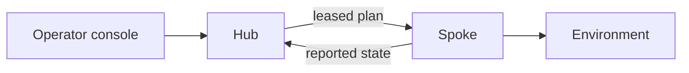

Conduit is a delivery control plane with explicit domain boundaries. The notes below are the short form. The linked documents are the contracts.

## Hub and Spoke

The Hub decides and records what may run. A Spoke runs inside one environment, asks the Hub for work, applies that work locally, and reports what it observed.

The Spoke initiates every control-plane exchange. It leases a plan through an outbound connection, renews the lease while working, and reports completion or failure. The Hub does not open a management connection into the environment. An environment may restrict ingress without preventing delivery.

The Hub owns desired state, immutable product and release coordinates, approval, plan compilation, lease issuance, and the durable record of reported state. It must not claim that a change succeeded from intent alone.

The Spoke authenticates as one environment and one agent, accepts only work leased for that identity, applies the plan, observes the result, rolls back completed steps when a later step fails, and reports exact outcomes. An expired lease is not live. A retry receives a new attempt number.

Application catalogs, charts, credentials, environment inventory, and installation configuration stay in the tenant or product repository. This repository contains the reusable control plane.

Full boundaries: [Hub and Spoke](https://github.com/jonathanagustin/conduit/blob/main/docs/architecture/hub-spoke.md) and [reconciliation](https://github.com/jonathanagustin/conduit/blob/main/docs/architecture/reconciliation.md).

## Bounded contexts

Working native contexts cover catalog, environments, governance, delivery, execution, reporting, artifacts, identity, and optimization. A compatibility facade remains under `internal/controlplane`. The refactor is not complete until behavior and consumers move behind narrow context ports.

Domain code depends on its own values and on narrow ports. Adapters depend inward. Composition wires them. Domain code does not import HTTP handlers, file stores, or provider clients. Generated transport types stop at the adapter. They do not become delivery, governance, execution, or persistence models.

The map of what each context owns, and the dependency rule, is [bounded contexts](https://github.com/jonathanagustin/conduit/blob/main/docs/architecture/bounded-contexts.md). The documentation index is [docs/README.md](https://github.com/jonathanagustin/conduit/blob/main/docs/README.md).

## Temporal workflows

[ADR 0013](https://github.com/jonathanagustin/conduit/blob/main/docs/decisions/0013-temporal-for-packaging-workflows.md) chooses Temporal as the durable engine for a packaging run: assessment, a proposal, validation, a human review wait, and a handoff into a plan. Activities perform external reads and writes. A signal or update only names an approval record that an activity reads back. It is not an approval.

That decision does not install Temporal in the Hub and does not authorize a production Temporal cluster. With no worker configured, `GET /v1/packaging-runs/{runID}` reports `configured: false`. The route has no write method. A small or disconnected install that does not supply a worker is a supported mode: the packaging run does not run. That mode is not a second workflow engine.

Plan status, leases, rollout, and observed state stay with the delivery kernel. [ADR 0015](https://github.com/jonathanagustin/conduit/blob/main/docs/decisions/0015-temporal-orchestrates-plan-execution.md) allows Temporal to sequence an approved plan behind that kernel. The Spoke still applies work and reports what it observed. The Hub's database remains the system of record for plans, approvals, leases, desired state, reported state, and the authorization audit.

## Gitless GitOps

Production clusters consume deployment sources from a private OCI registry. Git remains the authoring and review system. It is not a runtime dependency, and a production cluster does not hold a Git credential.

A person dispatches publication for an exact semantic release tag. A merge does not publish a release. The workflow records the registry-reported digest and signs that digest. A tag helps a person find a release. The digest is the deployment authority. Moving a tag does not change an approved plan.

The design and the decision are [Gitless GitOps](https://github.com/jonathanagustin/conduit/blob/main/docs/architecture/gitless-gitops.md) and [ADR 0001](https://github.com/jonathanagustin/conduit/blob/main/docs/decisions/0001-gitless-gitops.md). The rules that apply on every path, including approval before a plan is leaseable, are the [deployment invariants](https://github.com/jonathanagustin/conduit/blob/main/docs/architecture/deployment-invariants.md).

## Read the design

- [Hub and Spoke](https://github.com/jonathanagustin/conduit/blob/main/docs/architecture/hub-spoke.md)
- [Bounded contexts](https://github.com/jonathanagustin/conduit/blob/main/docs/architecture/bounded-contexts.md)
- [ADR 0013](https://github.com/jonathanagustin/conduit/blob/main/docs/decisions/0013-temporal-for-packaging-workflows.md) and [ADR 0015](https://github.com/jonathanagustin/conduit/blob/main/docs/decisions/0015-temporal-orchestrates-plan-execution.md)
- [Gitless GitOps](https://github.com/jonathanagustin/conduit/blob/main/docs/architecture/gitless-gitops.md)
