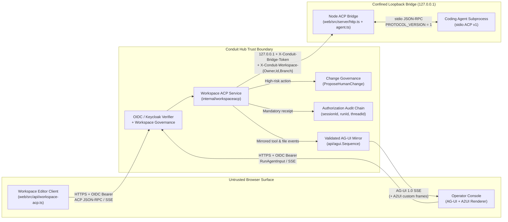

# Workspace editor, console, and agent connections (ACP, AG-UI, A2UI)

This document defines the three protocol boundaries used for interactive agent
workflows in Conduit, the governed-action mapping for coding-agent permissions,
and the trust boundary that keeps the coding-agent process unreachable from the
browser.

The Hub-mediated workspace ACP transport, risk classification, and console
projection are Conduit extensions (`valueTier: "CONDUIT_NATIVE"`, registered in
`docs/evidence/conduit-inventions.json` under `workspace.GovernedACPBridge`).
They claim compatibility only with the public wire contracts pinned in this
repository and never with private Palantir Apollo protocols.

## The three connections

| Connection | Wire contract | Endpoints | Purpose |
| --- | --- | --- | --- |
| **ACP** (Agent Client Protocol) | `@agentclientprotocol/sdk@2.6.0`, pinned `PROTOCOL_VERSION = 1` | Browser editor -> Hub `POST /v1/dev-workspaces/{workspaceID}/acp` and `POST /v1/dev-workspaces/{workspaceID}/acp/permissions/{requestID}` -> confined loopback Node bridge (`web/src/server/main.ts` `/acp`) -> stdio coding agent | Mediates interactive workspace coding-agent sessions (`initialize`, `session/new`, `session/set_config_option`, `session/prompt`, `session/cancel`, `session/close`) and governed permission settlements. |
| **AG-UI** (Agent-User Interaction) | `ag-ui-protocol/ag-ui` 1.0 JSON Schema (`api/agui/upstream/schema.json`) | Console -> Hub `POST /v1/agent-runs` and `POST /v1/dev-workspaces/{workspaceID}/agent-runs` (`text/event-stream`) | Streams validated `RUN_STARTED`, `STATE_SNAPSHOT`, `STATE_DELTA` (RFC 6902), `TEXT_MESSAGE_*`, `TOOL_CALL_*`, `MESSAGES_SNAPSHOT`, `RUN_FINISHED`, and `RUN_ERROR` exchanges for planning runs and mirrored workspace editor activity. |
| **A2UI** (Agent-to-UI) | `A2UI v0.8` bounded catalog (`web/src/console/a2ui/`) | Carried inside AG-UI `CUSTOM` events with `name: "a2ui"` | Renders declarative intake and confirmation forms (`surfaceUpdate`, `dataModelUpdate`, `beginRendering`, `deleteSurface`) using server-owned field schemas. |

## Trust boundary and route isolation

1. **No direct browser route to the agent process.** Neither Vite (`web/vite.config.ts`),
   Playwright (`web/playwright.config.ts`), nor the Hub exposes or proxies the
   Node bridge's `/api/assistant` or `/acp` ports to browsers.
2. **Loopback + secret token + browser-header rejection.** `internal/workspaceacp/adapters/nodebridge`
   binds the Node bridge on `127.0.0.1:0` with `CONDUIT_BRIDGE_REQUIRE_TOKEN=1`
   and a random 256-bit `CONDUIT_BRIDGE_TOKEN`. `verifyHubCaller` in
   `web/src/server/http.ts` rejects any request carrying browser fetch metadata
   (`Origin`, `Sec-Fetch-Site`, or `Sec-Fetch-Dest`) with `403`, verifies
   `X-Conduit-Bridge-Token` in constant time (`401` on mismatch), and enforces
   exact `X-Conduit-Workspace-Owner`, `X-Conduit-Workspace-Id`, and
   `X-Conduit-Workspace-Branch` headers (`403` on mismatch).
3. **Pinned ACP protocol version.** Both the Hub (`domain.ProtocolVersion = 1`)
   and the Node bridge (`PINNED_ACP_PROTOCOL_VERSION = 1` checked against
   `@agentclientprotocol/sdk` `PROTOCOL_VERSION`) verify `protocolVersion === 1`
   during `initialize` and reject version drift before creating a session.
4. **Workspace file-callback confinement.** `confineWorkspacePath` in
   `web/src/server/agent.ts` and `recorded.Tree` in
   `internal/devworkspace/adapters/recorded/store.go` resolve canonical paths and
   reject parent traversal (`..`), absolute paths outside the workspace root,
   and symlinks escaping the workspace directory. `INITIAL_AGENT_MODE=agent-full-access`
   is refused at startup and on `session/set_config_option`.

## User, branch, and OIDC scoping

- **Keycloak / OIDC authentication.** Workspace ACP routes authenticate callers
  through the Hub's `OperatorIdentityResolver` (`OIDCOperatorIdentityConfig`
  verifying issuer, audience, freshness, and claims for Keycloak/OIDC tokens;
  insecure identity headers remain gated behind `ALLOW_INSECURE_OPERATOR_IDENTITY_HEADERS`
  for local fixtures only). Service accounts are refused interactive workspace
  ACP sessions (`403`).
- **One user and one workspace branch.** Every ACP session is bound to
  `Scope{Owner, WorkspaceID, EnvironmentID, Branch}` where `Owner` must equal
  the workspace owner and `Branch` must resolve within
  `workspace/<owner>/<workspaceID>` (`domain.ResolveBranch`). Cross-user and
  cross-branch session reuse, prompt execution, or permission settlement is
  denied (`403`) and recorded in the authorization audit log.

## Governed-action mapping for ACP permissions

Standing approvals are disallowed: `SanitizeOptions` strips `allow_always` when
`allow_once` is present (or downgrades it to single-use `allow_once`), and the
Node bridge requires a fresh governed permission settlement for each actual
`fs/write_text_file` or `terminal/create` callback. Agent-supplied permission
requests cannot create a run-wide credit for a different path or command.
An agent permission prompt and the actual mutation callback can therefore require
separate decisions; approving the former does not preapprove the latter.

Every ACP permission request is classified by the stricter of the Hub's and
bridge's risk evaluations (`domain.ClassifyPermission` + `domain.StricterRisk`):

| Risk tier | Examples | Governed action | Execution rule |
| --- | --- | --- | --- |
| `low_confirm` | Confined workspace reads, edits to ordinary project files (`README.md`, `src/**`), bounded local test commands | **User Confirm** (`PENDING_CONFIRM`) | Remains blocked while pending; denied on `reject`/`deny`/`cancel`; executes once when the workspace owner submits an explicit `confirm` decision on `POST /v1/dev-workspaces/{workspaceID}/acp/permissions/{requestID}`. |
| `high_change_request` | Edits to `.github/**`, `deploy/**`, `.env*`, `secrets*`, `credentials*`; network or mutating infrastructure commands (`git push`, `kubectl`, `helm`, `terraform`, `curl`, `docker push`, `rm -rf`, `sudo`) | **Change Request** (`PENDING_CHANGE_REQUEST` via `GovernanceService.ProposeHumanChange`) | Opens a `WORKSPACE_ACP` `ChangeRequest` in `PENDING_APPROVALS`. Owner `confirm` returns `409 Conflict` while pending, `403` if rejected/cancelled, and `403` if self-approved; execution proceeds only after a **separate human reviewer** approves the Change Request. |

When a governed `fs/write_text_file` completes, the Hub commits the confined edit
to the workspace store via `ApplyGovernedEdit`, advancing `ProposalRevision` and
clearing any prior `ApprovalID` or `ValidationOutcome` so edited workspace trees
never inherit stale approvals.

## Mandatory audit correlation and console AG-UI mirroring

- **Audit log correlation.** Every session lifecycle event, permission request,
  permission decision, tool call (`workspace.acp.tool_call`), file write
  (`workspace.acp.file_write`), command (`workspace.acp.command`), and mirrored
  AG-UI frame appends an `AuthorizationCheckEvent` carrying `sessionId`,
  `runId`, `threadId`, `workspaceId`, `branch`, `valueTier: "CONDUIT_NATIVE"`,
  and content `sha256:` digests rather than raw file or secret contents. If the
  audit sink is unavailable, `Service.audit` fails closed (`503`).
- **Console AG-UI mirroring.** Each ACP session registers a mirrored thread
  (`wsp-acp-<id>`) in `internal/workspaceacp/agui.Mirror`. Prompt turns emit
  `api/agui.Sequence`-validated AG-UI 1.0 events (`RUN_STARTED`, `STATE_SNAPSHOT`,
  RFC 6902 `STATE_DELTA`, `TEXT_MESSAGE_*`, `TOOL_CALL_START` / `ARGS` / `END` /
  `RESULT`, `MESSAGES_SNAPSHOT`, and `RUN_FINISHED` / `RUN_ERROR`). Authorized
  console operators (the workspace owner or an operator holding `resource:read`
  on the workspace's environment) can subscribe to live or replayed editor
  activity via `POST /v1/dev-workspaces/{workspaceID}/agent-runs` or
  `POST /v1/agent-runs`.

## Offline-bundle mode

When `CONDUIT_OFFLINE_BUNDLE=1` (or `Options.WorkspaceACPOfflineBundle = true`):

1. `nodebridge.LoopbackOnlyHTTPClient(true)` resolves every target host before
   dialing and refuses any non-loopback IP address (`!ip.IsLoopback()`).
2. `childEnv` in `web/src/server/agent.ts` strips external provider credentials
   and proxy variables: `CODEX_API_KEY`, `OPENAI_API_KEY`, `ANTHROPIC_API_KEY`,
   `GEMINI_API_KEY`, `GITHUB_TOKEN`, `GH_TOKEN`, `HTTP_PROXY`, `HTTPS_PROXY`,
   `ALL_PROXY`, `http_proxy`, `https_proxy`, and `all_proxy`. It sets
   `CONDUIT_OFFLINE_BUNDLE=1`, `NO_PROXY=*`, and `no_proxy=*`. The real child-process
   regression in `web/src/test/unit/bridge.test.ts` verifies that Gemini, OpenAI
   and Codex fixture keys do not reach the agent. This explicit strip list is
   not an allowlist of every possible credential variable.
3. `startAgent` skips external ACP `authenticate` handshakes, and
   `createOfflineFetch` rejects any outbound HTTP/HTTPS call from the bridge to
   non-loopback hosts with `OFFLINE_BUNDLE_EGRESS_DENIED`.

## Review limitations: not ready for production promotion

The Node bridge runs agent and terminal subprocesses with a workspace working
directory and filtered environment; those settings are not an operating-system
filesystem or network sandbox. `createOfflineFetch` and the Go loopback client
restrict their own HTTP calls, not arbitrary sockets opened by those subprocesses.
The current offline fixture verifies only those HTTP and environment boundaries.
It does not prove #647's no-outside-network-call acceptance criterion for a real
agent. PR #691 remains draft pending enforced process isolation/egress and real
workspace sign-on/branch lifecycle evidence (#616, #618, #619, #638).

Risk classifiers use command text patterns; they are not a safe execution
sandbox or a complete shell analysis. File callback canonicalization does not
confine direct filesystem access by an unrestricted agent subprocess. These
limits must be resolved before treating this bridge as governed shared-state
execution or closing #647. The in-memory bridge is fixture evidence, not a live
coding-agent integration. Unconfigured Hub composition leaves the bridge disabled;
tests must inject the in-memory adapter explicitly. The experimental Node adapter
still requires explicit `DEVWORKSPACE_ACP_BRIDGE=node` selection.
