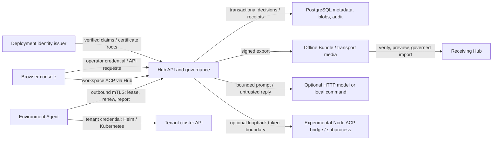

# Conduit threat model

Version 1, 2026-11-17. Source baseline:
[`de657c0266ece0e567b460d3d37aba1212658727`](https://github.com/jonathanagustin/conduit/tree/de657c0266ece0e567b460d3d37aba1212658727).
Scope: Conduit's native control plane and the optional integrations named below.
This is a repository analysis, not an independent assessment or deployment
accreditation. Referenced tests describe executable evidence at that baseline;
their presence is not a claim that this document ran them or exercised a tenant.

The [control evidence](CONTROL-EVIDENCE.md) records the corresponding bounded
mechanisms and deployer responsibilities. The [external review
scope](EXTERNAL-REVIEW-SCOPE.md) is **NOT COMMISSIONED**. Parent
[#846](https://github.com/jonathanagustin/conduit/issues/846) retains the external
review and FIPS decisions; this document does not close them. Apollo-facing
transport claims remain bounded by the pinned public contracts in
[tenant fidelity](../operations/TENANT-FIDELITY.md). This model makes no private
Apollo Hub-to-Agent compatibility claim.

## Assets and trust assumptions

| Asset | Security property and authority |
| --- | --- |
| Desired state, Plans, approvals and grants | Only authorized, policy-satisfying revisions become leaseable; intent remains distinct from observed success. |
| Environment and Agent identities, lease tokens | One verified Agent acts within its Environment and its live Plan lease. Issuer compromise can invalidate this assumption. |
| Product/Release coordinates, Bundle manifests and bytes | Digest-bound identity, trusted signatures and explicit import admission; a signature authenticates its signer, not the truth of every embedded assertion. |
| Hub metadata, immutable blobs and audit history | Transactional state and attributable decisions; independent checkpoint custody is needed against a database administrator rewriting history. |
| Tenant cluster credentials and material-provider references | The Agent's Kubernetes identity and configured provider determine actual reach. Product charts and added cluster grants are tenant-owned inputs. |
| Browser identity, displayed data and proposed actions | Presentation is untrusted; the Hub resolves credentials and authorizes each protected operation. |
| Source files, prompts, model replies and ACP events | Repository/provider content may be malicious. Model output is a proposal, never an approval or proof that execution occurred. |
| Signing keys, issuer roots, database/provider credentials | Deployment operators provision and protect them; no tenant values or credentials belong in this evidence record. |

The Hub process, its executable/configuration, host administrator and configured
identity issuers are trusted to enforce policy. A compromised Hub or issuer is
not contained by a signed Bundle or an audit hash chain. Cluster administrators
control effective Agent RBAC and admission policy. Reviewers must assess those
deployment assumptions rather than infer them from chart defaults. Publicly
reachable health, signing-key and console-asset routes do not imply public
access to protected API data; see the [route authorization
register](../operations/route-authorization.md).

## Data flows and boundaries

| Boundary | Current enforcement and evidence |
| --- | --- |
| Browser/operator to Hub | [Identity domain](../../internal/identity/domain/identity.go), [OIDC policy](../../internal/identity/domain/oidc.go), [HTTP credential adapter](../../internal/identity/adapters/httpidentity/httpidentity.go), grants and the [route matrix](../../internal/hub/composition/authorization_test.go). The console's [escaped bootstrap and CSP](../../internal/consoleui/handler.go) do not grant authority. |
| Agent to Hub | [TLS configuration](../../internal/controlplane/server_tls.go), [Agent transport](../../internal/agent/transport.go), Environment-scoped lease/health checks and `authorizeAgentForPlan` in the [handlers](../../internal/controlplane/http.go). [Lease values](../../internal/execution/domain/lease.go) bind token, Agent and expiry; ordinary and maintenance-admission routes require separate review. |
| Agent to cluster/material provider | [Worker](../../internal/agent/worker.go), [Helm execution](../../internal/agent/helm.go) and [material preparation](../../internal/agent/material.go). Outbound control traffic does not constrain the Kubernetes credential or an external preparer's authority. |
| Hub to state/audit | [PostgreSQL audit adapter](../../internal/governance/adapters/auditpostgres/store.go), [verifier](../../internal/governance/adapters/auditpostgres/verify.go) and [custody contract](../operations/authorization-audit-integrity.md). The [identity/governance note](../architecture/identity-and-governance.md#audit-contract) bounds which mutation decisions fail closed on audit failure. |
| Exporting Hub/media to receiving Hub | [Envelope digest/signature verification](../../internal/artifacts/domain/envelope.go), [Bundle service and import admission](../../internal/controlplane/bundles.go), [governed HTTP import tests](../../internal/controlplane/bundles_test.go). The [offline metadata UI service](../architecture/offline-bundle-controls.md) is a different, process-local surface and does not attest byte transfer or installation. |
| Hub to model/provider | [HTTP transport](../../internal/modelhttp/client.go), [local command execution](../../internal/localcmd/run.go), [planner framing](../../internal/planning/adapters/planner/framing.go), [source filtering](../../internal/packagingworkflow/adapters/packagingtools/secrets.go). Remote model infrastructure and any model CLI are additional trust domains. |
| Hub to experimental ACP bridge | [Governed ACP architecture](../architecture/workspace-acp-connections.md) binds user/workspace/branch and permission receipts. The optional Node subprocess has no established OS filesystem or network confinement; it is disabled unless explicitly selected. |

## Threat register

STRIDE labels identify spoofing (S), tampering (T), repudiation (R), information
disclosure (I), denial of service (D), and elevation of privilege (E). They are
review categories, not measured severity scores. “Remaining” describes residual
risk or assurance work, not a newly demonstrated exploit.

| ID / category | Scenario, prevention and detection evidence | Remaining risk and responsible follow-up |
| --- | --- | --- |
| TM-01 S/E | An unauthenticated caller or Agent attempts operator actions. The [identity domain](../../internal/identity/domain/identity.go) requires distinct operator and Agent URI paths; the [OIDC negative cases](../../internal/identity/domain/oidc_test.go) and [credential adapter tests](../../internal/identity/adapters/httpidentity/resolver_test.go) constrain invalid claims and failed-certificate fallback. | A trusted issuer can mint excessive identities; deployment owns issuer policy, roots and production configuration. Agent credential lifecycle remains [#847](https://github.com/jonathanagustin/conduit/issues/847). Review the assembled issuer/TLS/proxy deployment under #846. |
| TM-02 E/I | An Agent for Environment A requests B's lease or operates B's Plan. [Identity tests](../../internal/controlplane/identity_test.go) refuse a wrong-Environment certificate at lease admission; [handlers](../../internal/controlplane/http.go) also require the Plan Environment and owning Agent. [Lease tests](../../internal/execution/domain/lease_test.go) constrain token/Agent matching and expiry. | These checks exist; they are not an independent adversarial review of every route. The review brief includes maintenance-admission, health, Plan discovery, Bundle reach and all accepted credential combinations. |
| TM-03 I/E | An operator with grants on A reads or mutates B. `TestFilteredRoutesShowOneTenantNothingOfAnother` in the [route tests](../../internal/hub/composition/authorization_test.go), plus [approval](../../internal/controlplane/plan_approval_authorization_test.go) and [cancellation](../../internal/controlplane/plan_cancel_authorization_test.go) tests, exercise tenant separation. | Platform-wide grants intentionally have broader reach. Deployment owns grant/team/delegation assignment; new routes and new projections must preserve row-level filtering. Historical August audit statements are not evidence that these controls are absent now. |
| TM-04 T/E | A stolen, expired or superseded lease is replayed to start/renew/finish work. [Lifecycle](../../internal/controlplane/lifecycle.go) and [lease predicates/tests](../../internal/execution/domain/lease_test.go) enforce token and expiry rules; Agent renewal failure stops active work under the [worker contract](../architecture/hub-spoke.md). | A compromised currently authorized Agent can lie about observations or act locally. Independent review must exercise cross-replica races, attempt replacement and exact-boundary replay; a reported success is not an independent cluster attestation. |
| TM-05 T/E | Modified Bundle bytes, an untrusted signer, stale export selection or an unauthorized import changes state. [Envelope tests](../../internal/artifacts/domain/envelope_test.go) reject tampering and malformed resource/chunk identity. [Bundle tests](../../internal/controlplane/bundles_test.go) cover verification status, incremental checkpoints, recalled release selection and governed atomic import. Bundle reads require operator/platform read authority in the [HTTP handlers](../../internal/controlplane/http.go). | Trusted signing-key custody, target configuration and offline-media handling belong to deployment operators. Review replay/target/import-policy behavior rather than assuming a valid signature alone authorizes installation. Lifecycle/rotation work is #847. |
| TM-06 T/I | A caller submits a fresh but self-asserted PASS assessment or suppression provenance. The [artifact assessment path](../../internal/controlplane/scanner.go) checks shape, coverage and freshness, but `TestFreshAssessmentIsNotRescanned` in the [tests](../../internal/controlplane/scanner_test.go) explicitly retains fresh submitted evidence. | Authenticating evidence authorities is unresolved [#887](https://github.com/jonathanagustin/conduit/issues/887). Bundle signing does not authenticate the original assessment producer. Do not treat caller-supplied freshness as independently witnessed scanning. |
| TM-07 E/T | A compromised Agent or malicious Product chart uses cluster privileges to alter unrelated resources. The [Agent Helm path](../../internal/agent/helm.go) validates declared image coordinates; the chart's RBAC verifier checks a rendered floor. | The [readiness gap](../operations/PRODUCTION-READINESS.md) distinguishes that floor from effective tenant-added privileges and chart resource kinds. Tenant admins must inspect actual bindings, chart kinds and admission policy. Closing [#264](https://github.com/jonathanagustin/conduit/issues/264) did not establish a privilege ceiling. |
| TM-08 R/T | An operator or database administrator removes decisions or rewrites history. The [audit chain](../../internal/governance/domain/audit_chain.go), [PostgreSQL tests](../../internal/governance/adapters/auditpostgres/store_test.go) and [export verification](../../internal/governance/adapters/auditpostgres/export_test.go) detect inconsistent records and mismatched trusted prefixes. | A database owner can recompute an unanchored history. Independently retained checkpoints, retention capacity and response ownership are deployment obligations. Live pruning remains a separate [#865](https://github.com/jonathanagustin/conduit/issues/865) decision. Audit allow records describe a verdict, not proof of later execution. |
| TM-09 I/E | Malicious labels, bootstrap data or model-rendered content executes script or changes browser authority. [Console handler tests](../../internal/consoleui/handler_test.go) constrain escaping/CSP and [bootstrap validation](../../internal/consoleui/bootstrap_test.go) rejects capability/auth configuration. Native identity presentation uses escaped text, described in [console identity](../architecture/console-operator-identity.md). | CSP permits inline style attributes and is not a proof that every renderer is XSS-free. Browser compromise or stolen operator credentials retain that operator's authority. The Hub must keep authorizing requests independently of displayed identity. |
| TM-10 E/T | Repository files or tool results prompt a model to bypass review. [Planner framing tests](../../internal/planning/adapters/planner/framing_test.go), [assistant framing](../../internal/assistant/domain/prompt.go) and [source-secret tests](../../internal/packagingworkflow/adapters/packagingtools/secrets_test.go) constrain framing and selected disclosure paths. Tool proposals still pass Hub policy. | Framing/redaction is incomplete by nature and is not an execution sandbox. Human review must inspect exact outputs and coordinates; model-authored text cannot grant approval or establish completion. |
| TM-11 I/E | A local model CLI reads mounted credentials or opens network sockets. [Command execution](../../internal/localcmd/run.go) uses a temporary working directory and [allowlisted environment](../../internal/localcmd/env.go); delegated provider calls use the same policy. | At this baseline it still runs as the Hub UID with access to readable host files and ordinary sockets; provider credentials, HOME and optional allowlist extensions remain available. [#809](https://github.com/jonathanagustin/conduit/issues/809) tracks the remaining CLI isolation/replacement work. A planned retirement is not a current control. Prefer the HTTP adapter when local process access is unacceptable. |
| TM-12 I/T/D | A model endpoint leaks prompts/keys through redirects or returns excessive/malicious data. [HTTP tests](../../internal/modelhttp/client_test.go) constrain HTTPS configuration, off-origin redirects, key-file rereads, deadlines and the 4 MiB response limit. | Endpoint/proxy operators see submitted data; deployers select data policy, CA roots, network egress and key custody. Explicit non-loopback plaintext opt-in weakens this hop. These bounds do not prove global quota/capacity or provider trust. |
| TM-13 E/I/R | An experimental ACP agent bypasses a denied permission through direct process access. [ACP documentation and evidence](../architecture/workspace-acp-connections.md) cover Hub-mediated owner/branch scoping, single-use callback permissions and mandatory correlated audit. | Loopback/token filtering and confined callbacks do not isolate arbitrary subprocess filesystem/network operations. [#647](https://github.com/jonathanagustin/conduit/issues/647) and [#616](https://github.com/jonathanagustin/conduit/issues/616) remain the production isolation boundary; no real-agent no-egress claim is established. |
| TM-14 D/R | Expensive API/model work, oversized inputs or audit growth exhausts capacity. [JSON body limits](../../internal/controlplane/http.go), provider deadlines and [audit read/export bounds](../operations/authorization-audit-integrity.md) constrain individual operations. | Per-operation limits do not establish total service capacity. [#842](https://github.com/jonathanagustin/conduit/issues/842) and [#849](https://github.com/jonathanagustin/conduit/issues/849) track quota and capacity work. Deployment owns storage/backup capacity, external dependencies and alert response; do not infer a service-level guarantee. |

## Use and maintenance

Before enabling an optional path, the deployment owner should bind the model to
an exact Conduit image digest, rendered configuration and actual trust roots;
exercise the relevant negative case; retain a sanitized receipt; and record who
accepts the remaining risk. Preserve exact reported outcomes and rollback
failures rather than translating desired state into success.

Update this version and its evidence baseline when identity carriers, route
authorization, lease behavior, Bundle admission, model execution, ACP isolation,
or audit custody changes. Recheck linked issues against landed source; issue
closure alone is not evidence of a control. New verified gaps belong in issues,
with sanitized reproduction and existing duplicates checked first. Disclosure
channel/support policy remains a separate owner decision in
[#845](https://github.com/jonathanagustin/conduit/issues/845).
