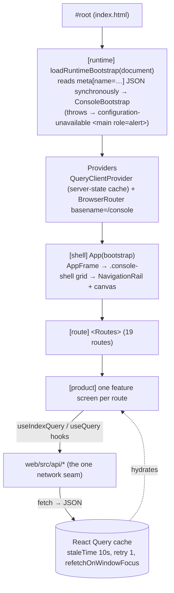

# Console composition trees

> **Historical, marked 2026-11-17.** This note describes a React console that
> is no longer in the tree. `App.tsx`, `AppFrame`, `NavigationRail` and
> `useIndexQuery`, which it names throughout, do not exist under `web/src` at
> this date. The console served from `/console/` is `web/src/console/Workbench.tsx`
> mounting the operator engine in `web/src/console/operator/engine.js`. The
> trees below are kept unedited as the record of the earlier console. They
> are not a description of the current one and must not be cited as one.
> For current navigation see `console-navigation.md`.

A composition tree for every operator-console screen, in the Foundry
application-decomposition notation. This is the structural complement to
`console-visual-language.md`: that note measures the console's palette, type and
geometry; this one records, per route, which regions nest inside which, which
UI-library primitive draws each leaf, and where the screen's data is hydrated
from.

## Notation

Every node is `[owner] RegionName (geometry / behavior contract) -> [BP]
primitives`. The trees are **route-rooted**: each screen's tree starts at the
`[route]` mount, and the standing chrome above it (`[runtime]`, `[shell]`,
`[shared]`) is factored out once in *Root and hydration model* and referenced,
not repeated.

Owner labels, from outermost to innermost:

| Label | Meaning | In this console |
| --- | --- | --- |
| `[runtime]` | Boot/config seam that runs before the app tree exists | `web/src/runtime/bootstrap.ts` — the synchronous `<meta>` tenant read |
| `[shell]` | Persistent workspace shell + navigation around every route | `AppFrame` + `.console-shell` grid + `NavigationRail` |
| `[route]` | App-mount boundary — one React Router `<Route>` element | each `<Route>` in `App.tsx` |
| `[shared]` | Shared route/resource chrome reused across ≥2 routes | anything in `web/src/components` (`AppHeader`, `ObjectHeader`, shared table bands, `IndexPagination`, `FacetRail`, the status tags, `ReleaseChannelGraph`, `TransitionDetail`) |
| `[product]` | Product-owned layout, state and renderer for one screen | each feature composition in `web/src/features/<screen>/` |
| `[BP]` | An actual UI-library v6 primitive, named as imported from `@blueprintjs/core` | never a look-alike; a raw `<section>`/`<ul>`/`<dl>` is written as such |
| `[portal]` | A leaf the UI library renders **outside** the route subtree, into a document-level portal | collapsed-rail Applications popover, per-item tooltips, `ObjectHeader` Actions menu |
| `?` | Optional / conditional node — present only in a named state | e.g. a detail panel only when a row is selected; a `Callout` only on error |

Two labels the Foundry vocabulary carries are, by design, **not used here**, and
their absence is itself a finding (see *Findings*):

- **`[engine]`** — a Mapbox/Canvas/Monaco/WebGL rendering surface. No console
  screen owns one; every screen is UI-library-over-DOM. The console has no map,
  code editor, or free canvas.

The label rule is mechanical and file-location grounded: **shell chrome and
anything reused from `web/src/components` is `[shared]`; anything authored under
`web/src/features/<screen>/` is `[product]`; UI-library imports are `[BP]`;
the UI library overlays that escape the subtree are `[portal]`.** The geometry in
parentheses is the measured contract — widths, grid tracks, row bands, corners,
insets — read from each screen's CSS (`web/src/**/*.css`) and `.tsx`, not
asserted. Archetype names ("browser", "review queue", "dashboard") are the ones
`console-visual-language.md` section 8 assigns.

**Grounding.** These trees are grounded in the code as of the current `main`.
Every region, primitive, hydration source and measurement was read from the file
that renders it; none is invented. Where a screen has no rail its tree has no
rail; where a value is not set in the CSS it is not stated.

---

## Root and hydration model

There is exactly one mount, one config seam, one server-state cache, and one
network seam. Everything below hangs off them.



- **`[runtime]` seam — `web/src/runtime/bootstrap.ts`.** `main.tsx` calls
  `createRoot(#root)` then `loadRuntimeBootstrap(document)`, which reads one
  `<meta name="…">` blob and `parseRuntimeBootstrap`s it into a validated
  `ConsoleBootstrap` (tenant id/displayName, brand title/subtitle/accent/icon,
  provenance claim-class). This is synchronous and pre-tree: on failure the app
  never mounts and a `<main role="alert" data-testid="console-configuration-unavailable">`
  renders instead. Brand + tenant flow into `AppFrame`; nothing else reads the
  bootstrap.
- **Server-state boundary — the React Query cache (`app/providers.tsx`).** The
  only hydration boundary in the console. `QueryClientProvider` wraps everything;
  queries default to `staleTime: 10_000`, `retry: 1`, `refetchOnWindowFocus:
  true` — *"the console polls; it does not hold a socket open."* There is
  deliberately **no general client-side store**: server state lives in the query
  cache, route state in the URL (`BrowserRouter basename="/console"` +
  `useSearchParams`/`useParams`), form state stays local. Each screen's
  *Hydration boundary* line below names the `web/src/api/*` module and hook that
  feed its cache entries.
- **`[shell]` — `App.tsx`.** `AppFrame` draws `AppHeader` and owns the skip-link;
  inside it, `.console-shell` is the `grid-template-columns: var(--console-rail)
  minmax(0,1fr)` frame holding `NavigationRail` and `.console-shell__canvas`. The
  canvas renders a session-capabilities `Callout` (`?`, only when
  `useSession().error`) above `<Routes>`.
- **`[route]` — the 19 routes.** `/` and `/overview` both mount `OverviewPage`;
  the rest map one path to one feature screen, with `:param` detail routes for
  environments, products, plans, change-requests and teams; `*` → `NotFound`.

### Shared chrome (factored out of every route tree)

`AppHeader` and `NavigationRail` are the standing `[shell]` chrome; `ObjectHeader`
is a `[shared]` component each feature renders as its own first child (owned
`[shared]`, but appearing inside the `[product]` subtree of each screen).

```
[shell] AppFrame (console-app-frame; skip-link -> main#main-content, tabIndex -1)
├─ [shared] AppHeader (50px band app-header.css:6; 1px bottom divider :10-11; identity tile 50×50 flush-left with 1px right divider; 24px mark AppLogo.tsx round(50*0.48); title stack pad 0 12px, module title 16px/600, subtitle 12px muted; actions margin-left auto, pad-right 14px, gap 8px)
│  └─ [BP] Navbar (role banner) + Icon/AppLogo(Icon) + b/small titles + optional Tabs/lead/search/actions slots
├─ [shell] NavigationRail (two-state dark rail navigation-rail.css, bp6-dark; width from the shell `--console-rail` track app.css: 230px expanded / 48px collapsed; state from useRailCollapsed.ts, forced collapsed ≤800px)
│  ├─ [product] header — pinned collapse toggle → [BP] Tooltip + Button (variant minimal, double-chevron)  ?only when the viewport does not force the state
│  ├─ [product] scroll region (the stack's one overflow owner; 10px section gap) with [BP] Divider between the two groups
│  │  ├─ [product] primary group (data-testid rail-primary) → per-dest [BP] NavLink + Icon; expanded: 32px row, 17px inset, Icon 16 + 12px gap + ellipsized Text label; collapsed: 36×36 icon tile (2px corner, 44px @≤600) + per-item [portal] Tooltip
│  │  └─ [product] Applications group — expanded: [BP] Text heading "Applications" (12px/600 uppercase, 32px) + 36px NavLink rows (data-testid rail-applications); collapsed: [portal] PopoverNext + Menu + MenuItem grid (aria-label "Applications")
│  └─ active = route state (aria-current) → primary-tinted fill + 4px left indicator; hover = neutral fill (not selection)
└─ [shared] ObjectHeader (~50px subheader band; pad 10px 16px, gap 10px object-header.css:9; 1px bottom divider; 30px AppLogo; kind 12px uppercase 0.04em; title 16px/600/20 via EntityTitle)
   └─ [BP] AppLogo(Icon) + EntityTitle + Tag tags (gap 6px) + [portal] Popover/Menu/MenuItem "Actions" button  ?only when actions supplied
```

Two more `[shared]` contracts every list inherits:

```
[shared] Shared table bands (console-table.css, scoped to .console-app-frame)
└─ [BP] HTMLTable → th 12px/600 muted ~32px (8px top/bottom pad + 16px line); td keep UI-library 11px pad → ~40px simple / 51–60px rich; all cells left-aligned

[shared] IndexPagination (index-pagination.css)
├─ ControlStrip band (form.console-index-controls, pad 10px 20px, gap 8px; InputGroup min-width min(360px,70vw))
└─ Pagination band (pad 10px 20px, gap 16px, space-between) → [BP] Button (Previous/Next)
```

Rail note: the rail carries `overview, environments, products, notifications` as
primary destinations and `change-requests, fleet, plans, promotions, export,
import, risk, teams` as the Applications group (`web/src/app/navigation.ts`).
Expanded, the Applications group is labeled rows under an "Applications" heading;
collapsed, it folds back into the Applications popover, and the labels and
heading give way to icons + tooltips. The primary destinations are the unheaded
core region above the first section divider — `navigation.ts` names exactly one
group ("Applications"), so a second heading would be inventing a taxonomy the
model does not have. Search and Settings are deliberately absent (no Hub
contract behind them).

---

## /overview  (also /)  ·  dashboard archetype

`web/src/features/overview/OverviewPage.tsx`. A panel grid of only the things
that need a person; an all-clear fleet renders one non-ideal state, not six
empty panels.

**Hydration boundary:** `api/overview.ts` `useOverview()` → one aggregate read;
each panel count comes from that single cache entry.

```
[route] / , /overview
└─ [product] OverviewPage (dashboard archetype; console-overview pad 16px)
   ├─ [shared] ObjectHeader (icon dashboard, kind "Control plane", title "Overview")
   ├─ [product] Incomplete-read banner  →  [BP] Callout (warning, "This page is incomplete")  ?only when a source is UNAVAILABLE
   ├─ [product] Nothing-to-do state  →  [shared] AccessibleNonIdealState (tick-circle)  ?only when every count 0 and nothing unreadable
   └─ [product] Panel grid  →  grid-template-columns: repeat(auto-fill, minmax(280px,1fr)); gap 12px (overview.css:3-6)
      └─ [product] Panel ×6 (Awaiting approval / Failed Plans / Running Plans / Unhealthy Entities / Stale reports / Blocked promotions)
         └─ [BP] Section + SectionCard (4px corner from --bp-surface-border-radius) → title Link + rightElement Tag (round, intent by count) + ul of Link + Tag (minimal round) items; "Clear" / "Could not be read" leaf when empty
```

---

## /fleet  ·  browser archetype

Verified template, reproduced verbatim. `web/src/features/fleet/FleetPage.tsx`.

**Hydration boundary:** `api/fleet.ts` `useFleet()`, keyed by the `useSearchParams`
query; the search/refresh controls rewrite the URL, which re-keys the cache read.

```
[route] /fleet
└─ [product] FleetPage (browser archetype)
   ├─ [shared] ObjectHeader (icon applications, kind "Application", title "Fleet")
   ├─ [product] Stale banner  →  [BP] Callout (warning)  ?only when stale installations exist
   ├─ [product] SummaryBar  →  [BP] Tag (large minimal; per-health buckets + stale, warning intent)
   ├─ [product] ControlStrip (flex row, gap 8px)  →  [BP] InputGroup (search) + Button (Search, submit) + Button (Refresh, icon, loading)
   ├─ [product] BrowserGrid  →  grid-template-columns: var(--console-rail:240px) minmax(0,1fr); gap 20px (fleet-page.css:6,19)
   │  ├─ [product] FleetFacetRail (240px fixed rail)  →  [shared] FacetRail
   │  │  └─ [BP] Section + SectionCard + ProgressBar + Tag (count, minimal round) + Button (value select) + Collapse ("N more")
   │  └─ [product] FleetTable (minmax(0,1fr) fluid work; one scroll owner, min-width:0)
   │     └─ [BP] HTMLTable (interactive, striped) → [shared] HealthTag/RolloutTag/ConfigTag/LifecycleTag status cells + Button row actions; row bands from console-table.css: header ~32px/12px muted, rows 40–60px
   └─ [product] Pagination (inlined in FleetPage, not the shared IndexPagination; same two-Button band, band 10px 20px fleet-page.css:68)
      └─ [BP] Button controls
```

---

## /environments  ·  browser archetype

### /environments — list (`EnvironmentsPage.tsx`)

**Hydration boundary:** `api/resources.ts` `useEnvironments()` via `useIndexQuery`
(cursor + search folded into the query key).

```
[route] /environments
└─ [product] EnvironmentsPage (browser archetype; --console-rail:260px, pad 16px environments.css:7)
   ├─ [shared] ObjectHeader (icon cloud, kind "Resource collection", title "Environments")
   └─ [product] Index panel  →  [BP] Section (compact, icon cloud, title "Visible Environments" via H2) + SectionCard (padded=false); .console-index margin 12px 16px
      ├─ [product] ControlStrip (form.console-index-controls)  →  [BP] InputGroup + Button (Search)
      ├─ [product] EnvironmentsTable  →  [BP] HTMLTable (interactive, striped) → Link (id) + Tag (connection / "never reported" warning) + Timestamp
      ├─ [product] Mobile records (dl grid, @≤767px)
      └─ [shared] IndexPagination
```

### /environments/:environmentId — detail (`EnvironmentDetailPage.tsx`)

**Hydration boundary:** `api/resources.ts` `useEnvironment()` + `usePlans()` and
`api/catalog.ts` `useEnvironmentCommands()`, keyed by the `:environmentId` param;
tabs read from already-cached entries, no per-tab refetch of the header.

```
[route] /environments/:environmentId
└─ [product] EnvironmentDetailPage (console-environment)
   ├─ [shared] ObjectHeader (icon cloud, kind "Environment", title = id, subtitle "reporting via <agent>", tag = connection setting)
   └─ [BP] Tabs / Tab (renderActiveTabPanelOnly): Overview · Plans · Commands
      ├─ [product] Overview tab — BrowserGrid  →  grid-template-columns: var(--console-rail:260px) minmax(0,1fr); gap 20px (environments.css:18-21); rail collapses @≤900px
      │  ├─ [product] OverviewSummary pane (fixed 260px)  →  [BP] Section + SectionCard ("Health", "Generation") + Tag (warning "N drifted")  ?drift tag only when drifted>0 + Timestamp
      │  └─ [product] EntitiesPanel work (minmax(0,1fr), min-width:0)  →  [BP] HTMLTable (striped) → [shared] HealthTag + LifecycleTag; [BP] Callout (warning "never reported")  ?; mobile dl records @≤767px
      ├─ [product] Plans tab  →  [BP] HTMLTable (striped) → NavLink + [shared] PlanStatusTag; mobile dl records
      └─ [product] Commands tab  →  [BP] HTMLTable (striped) → [shared] PlanStatusTag + Timestamp; mobile dl records
```

---

## /products  ·  browser archetype

### /products — list (`ProductsPage` in `ProductsPage.tsx`)

**Hydration boundary:** `api/catalog.ts` `useProducts()` via `useIndexQuery`.

```
[route] /products
└─ [product] ProductsPage (browser archetype; --console-rail:260px, pad 16px products.css:5)
   ├─ [shared] ObjectHeader (icon cube, kind "Resource collection", title "Software Catalog")
   └─ [product] Index panel  →  [BP] Section (compact, icon cube, title "Visible Products" via H2) + SectionCard (padded=false)
      ├─ [product] ControlStrip  →  [BP] InputGroup + Button (Search)
      ├─ [product] ProductsTable  →  [BP] HTMLTable (interactive, striped) → Link (product) + release/latest cells
      ├─ [product] Mobile records (dl grid)
      └─ [shared] IndexPagination
```

### /products/:product — detail (`ProductDetailPage` in `ProductsPage.tsx`)

**Hydration boundary:** `api/catalog.ts` `useProductReleases()` + `usePromotions()`,
keyed by the `:product` param.

```
[route] /products/:product
└─ [product] ProductDetailPage (console-products)
   ├─ [shared] ObjectHeader (icon cube, kind "Product", title = product, subtitle "N Releases")
   └─ [product] BrowserGrid  →  grid-template-columns: var(--console-rail:260px) minmax(0,1fr); gap 20px (products.css:13-16); rail collapses @≤900px
      ├─ [product] ProductResourceSummary pane (fixed 260px)  →  [BP] Section + SectionCard ("Resource") → dl facts (coordinate mono) + Tag (channels minimal round; "N with active findings" warning  ?)
      └─ [product] Work column (min-width:0, flex column, gap 16px)
         ├─ [product] ProductPromotionPipeline  →  [BP] Section + SectionCard ("Release Channel pipeline") → [shared] ReleaseChannelGraph + TransitionDetail
         ├─ [product] Release table  →  [BP] HTMLTable (striped) → Tag (channels) + mono digest cell + [shared] AssessmentTag (Tag) wrapped in [BP] Button when findings expandable
         └─ [product] VulnerabilityDetail (inline, revealed by row)  ?only when a release row is expanded  →  [BP] Section + SectionCard ("Vulnerability findings for <ver>") → HTMLTable ×2 (active findings, suppressed)
```

The pipeline and assessment panels are real UI-library `Section`/`SectionCard`, so
their 1px hairline, white surface and 4px corner come from
`--bp-surface-border-radius`, not from `products.css` (noted at `products.css:26`).

---

## /promotions  ·  review-queue archetype

`web/src/features/promotions/PromotionsPage.tsx`. A fleet-wide promotions view,
labelled a Conduit extension in its own banner. No `ObjectHeader`.

**Hydration boundary:** `api/catalog.ts` `usePromotions()` via `useIndexQuery`.

```
[route] /promotions
└─ [product] PromotionsPage (review queue; console-promotions pad 16px)
   ├─ [product] Scope banner  →  [BP] Callout (info-sign, compact — "this fleet-wide view is a Conduit extension")
   ├─ [product] ControlStrip (form.console-index-controls)  →  [BP] InputGroup + Button (Search)
   ├─ [product] Per-Product group ×N  →  [BP] Section (compact, title = product; card margin-bottom 12px, pad 12px promotions.css:2) + SectionCard (padded)
   │  ├─ [shared] ReleaseChannelGraph (ordered <ol> of channels; each transition a Button)
   │  └─ [shared] TransitionDetail (inline, revealed by selecting a transition)  ?only when a transition is selected  →  [BP] Callout + Tag + ul of blockers
   └─ [shared] IndexPagination
```

---

## /plans  ·  browser archetype

### /plans — list (`PlansPage.tsx`)

**Hydration boundary:** `api/resources.ts` `usePlans()` via `useIndexQuery`.

```
[route] /plans
└─ [product] PlansPage (browser archetype; console-plans)
   ├─ [shared] ObjectHeader (icon gantt-chart, kind "Execution history", title "Plans")
   └─ [product] Index panel  →  [BP] Section (compact, icon gantt-chart, title "Visible Plans" via H2) + SectionCard (padded=false)
      ├─ [product] ControlStrip  →  [BP] InputGroup + Button (Search)
      ├─ [product] PlansTable  →  [BP] HTMLTable (interactive, striped) → Link + [shared] PlanStatusTag + Timestamp
      ├─ [product] Mobile records (dl grid)
      └─ [shared] IndexPagination
```

### /plans/:planId — detail (`PlanDetailPage.tsx`)

**Hydration boundary:** `api/resources.ts` `usePlan()`, keyed by `:planId`.

```
[route] /plans/:planId
└─ [product] PlanDetailPage (console-plan-detail, pad 16px)
   ├─ [shared] ObjectHeader (icon gantt-chart, kind "Plan", title = id, subtitle env/generation/created; tags = PlanStatusTag + Tag "N of M approvals")
   ├─ [product] Failure / cancellation banners  →  [BP] Callout (danger / warning)  ?on failure/cancellation
   ├─ [product] Steps  →  [BP] H4 + HTMLTable (striped): #/Action/Entity/Product/Version/Namespace
   └─ [product] Task timeline  →  [BP] H4 + <ol>.console-plan-detail__timeline (order is the information)
      └─ per task: [BP] Tag (phase) + Tag (status intent) + Callout (danger, task failure  ?) + Section/SectionCard diagnostics (collapsible, open by default on failure, 4px via --bp-surface-border-radius) + Pre (agent output)
```

---

## /change-requests  ·  review-queue archetype

### /change-requests — list (`ChangeRequestsPage.tsx`)

The inbox: requests awaiting approval sort first. This index mounts the shared
`ObjectHeader` and titles its `Section` with the shared `H2` renderer, in line
with every other index screen (Finding 1, resolved).

**Hydration boundary:** `api/resources.ts` `useChangeRequests()` via `useIndexQuery`.

```
[route] /change-requests
└─ [product] ChangeRequestsPage (review queue)
   ├─ [shared] ObjectHeader (icon inbox, kind "Resource collection", title "Change Requests")
   └─ [product] Index panel  →  [BP] Section (compact, icon inbox, title "Change Requests" via H2) + SectionCard (padded=false)
      ├─ [product] ControlStrip  →  [BP] InputGroup + Button (Search)
      ├─ [product] ChangeRequestsTable  →  [BP] HTMLTable (interactive, striped) → Link + [shared] ChangeStatusTag (Tag) + Tag (outstanding count, warning)
      └─ [shared] IndexPagination
```

### /change-requests/:changeRequestId — detail (`ChangeRequestDetailPage.tsx`)

Routes to a full page (not an inline detail pane); the decision actions live here.

**Hydration boundary:** `api/resources.ts` `useChangeRequest()` + `usePlan()` and
`api/session.ts` `useSession()` (to gate the review form), keyed by
`:changeRequestId`.

```
[route] /change-requests/:changeRequestId
└─ [product] ChangeRequestDetailPage (console-change, pad 16px)
   ├─ [shared] ObjectHeader (icon inbox, kind "Change Request", title "id · title", subtitle env/author; tag = ChangeStatusTag)
   ├─ [product] Description  →  <p> (muted, max 70ch) ; evaluation error  →  [BP] Callout (danger)  ?on error
   ├─ [product] Who must review  →  [BP] H4 + HTMLTable (striped) → Tag (outstanding warning)
   ├─ [product] What the policies said  →  [BP] H4 + HTMLTable (striped)
   ├─ [product] What changes  →  [BP] H4 + Card per change (console-change__diff pad 12px) → Tag + HTMLTable (compact, striped) field diff
   ├─ [product] Reviews  →  [BP] H4 + <ul> → Tag (decision)
   ├─ [product] Consequence  →  [BP] H4 + Callout (gantt-chart / warning / info-sign)
   └─ [product] Review form  →  [BP] H4 + Callout (danger, on error  ?) + TextArea (rationale) + action row [BP] Button (Reject danger / Approve primary / Cancel) ; separate [BP] Button (Reopen, no rationale)  ?by session capability + state
```

---

## /export  ·  review-queue archetype (row → inline detail)

`web/src/features/exports/ExportPage.tsx`. Selecting a row reveals its detail
inline; there is no build-history endpoint, so none is shown.

**Hydration boundary:** `api/exports.ts` `useExportPipelines()` via `useIndexQuery`;
the row → detail selection is local URL/state, hydrated from the already-loaded
list (no per-row refetch).

```
[route] /export
└─ [product] ExportPage (review queue)
   ├─ [shared] ObjectHeader (icon export, kind "Resource collection", title "Export")
   └─ [product] Index panel  →  [BP] Section (compact, icon export, title "Export pipelines" via H2) + SectionCard (padded=false)
      ├─ [product] ControlStrip  →  [BP] InputGroup + Button (Search, local filter)
      ├─ [product] PipelinesTable  →  [BP] HTMLTable (interactive, striped) → Tag (status / build strategy / success guarantees); rows selectable, selected bg rgba(45,114,210,.15)
      └─ [product] DetailPanel (inline, nonmodal)  ?only when a row is selected  →  [BP] Section + SectionCard (compact, title via H2, .console-exports__detail; 1px hairline + 4px corner from --bp-surface-border-radius)
         └─ h3 + <ul> selections (each with [BP] Tag) + <dl> meta grid minmax(16rem,1fr), gap 16px
```

---

## /import  ·  review-queue archetype (row → inline detail)

`web/src/features/imports/ImportPage.tsx`.

**Hydration boundary:** `api/imports.ts` `useBundleImports()` via `useIndexQuery`;
inline detail from the loaded list.

```
[route] /import
└─ [product] ImportPage (review queue)
   ├─ [shared] ObjectHeader (icon import, kind "Resource collection", title "Import")
   └─ [product] Index panel  →  [BP] Section (compact, icon import, title "Bundle imports" via H2) + SectionCard (padded=false)
      ├─ [product] ControlStrip  →  [BP] InputGroup + Button (Search, local filter)
      ├─ [product] ImportsTable  →  [BP] HTMLTable (interactive, striped) → mono bundle cell + Link (environment) + Tag (status intent) + Timestamp; rows selectable
      └─ [product] DetailPanel (inline, nonmodal)  ?only when a row is selected  →  [BP] Section + SectionCard (compact, title via H2, .console-imports__detail; 1px hairline + 4px corner from --bp-surface-border-radius)
         └─ <dl> meta grid minmax(18rem,1fr) + Link (change request) + Timestamp; danger error <p> (#cd4246)  ?; h3 "Tasks" + <ol> → [BP] Tag (status) per stage
```

---

## /risk  ·  review-queue archetype (row → inline detail)

`web/src/features/risk/RiskPage.tsx`. Recalls that withdraw Release ranges.

**Hydration boundary:** `api/risk.ts` `useRetirements()` via `useIndexQuery`;
inline detail from the loaded list.

```
[route] /risk
└─ [product] RiskPage (review queue)
   ├─ [shared] ObjectHeader (icon shield, kind "Resource collection", title "Risk Management")
   └─ [product] Index panel  →  [BP] Section (compact, icon shield, title "Recalls" via H2) + SectionCard (padded=false)
      ├─ [product] ControlStrip  →  [BP] InputGroup + Button (Search, local filter)
      ├─ [product] RecallsTable  →  [BP] HTMLTable (interactive, striped) → [shared] SourceTag (Tag: SECURITY danger / MANUAL primary) + Tag (active warning / reverted); rows selectable
      └─ [product] DetailPanel (inline, nonmodal)  ?only when a row is selected  →  [BP] Section + SectionCard (compact, title via H2, .console-risk__detail; 1px hairline + 4px corner from --bp-surface-border-radius)
         └─ <dl> meta grid minmax(16rem,1fr) + Timestamp (freeze-until)
```

---

## /notifications  ·  review-queue archetype (row → inline detail)

`web/src/features/notifications/NotificationsPage.tsx`. An inbox above a
per-resource preference editor.

**Hydration boundary:** `api/notifications.ts` `useInbox()` (channel via
`useSearchParams`), `usePreference()` (loaded on demand) + `useSavePreference()`
mutation.

```
[route] /notifications
└─ [product] NotificationsPage (review queue)
   ├─ [shared] ObjectHeader (icon notifications, kind "Operator", title "Notifications", subtitle = owner)
   ├─ [product] Inbox panel  →  [BP] Section (compact, icon inbox, title "Inbox" via H2, rightElement = HTMLSelect channel) + SectionCard (padded=false)
   │  ├─ [product] InboxTable  →  [BP] HTMLTable (fixed layout, interactive, striped; fixed column tracks 8rem/20rem/22rem/…/10rem notifications.css:12-40) → Timestamp + Tag (type, wraps) + mono rid cell (0.85em) + Tag (environment); rows selectable
   │  └─ [product] Bounded note  →  [BP] Callout (primary, "most recent N entries")
   └─ [product] PreferenceSection  →  [BP] Section (compact, icon cog, title "Your preference for a resource" via H2) + SectionCard (padded=false)
      ├─ [product] ControlStrip (form)  →  [BP] InputGroup (resource RID) + Button (Load preference)
      └─ [product] PreferenceEditor (console-notifications__preference, pad 12px 16px)  ?only after a preference is loaded
         └─ [BP] Callout (absent/danger  ?) + dl meta + Switch (all future types) + fieldset.console-notifications__types (1px border, 2px corner) of Checkbox + Callout (unknown types  ?) + Button (Save preference)
```

---

## /teams  ·  browser archetype

### /teams — list (`TeamsPage` in `TeamsPage.tsx`)

Bounded named array with no server cursor, so **no `IndexPagination`** and no
mobile-record reflow — see findings.

**Hydration boundary:** `api/teams.ts` `useTeams()` — one bounded read, filtered
locally (no cursor in the query key).

```
[route] /teams
└─ [product] TeamsPage (browser archetype)
   ├─ [shared] ObjectHeader (icon people, kind "Resource collection", title "Teams")
   └─ [product] Index panel  →  [BP] Section (compact, icon people, title "Visible Teams" via H2) + SectionCard (padded=false)
      ├─ [product] ControlStrip  →  [BP] InputGroup + Button (Search, local filter)
      └─ [product] TeamsTable  →  [BP] HTMLTable (interactive, striped) → Link (name) + mono coordinate span (0.85em teams.css:2-4)
```

### /teams/:teamName — detail (`TeamDetailPage` in `TeamsPage.tsx`)

**Hydration boundary:** `api/teams.ts` `useTeam()`, keyed by `:teamName`.

```
[route] /teams/:teamName
└─ [product] TeamDetailPage (console-teams)
   ├─ [shared] ObjectHeader (icon people, kind "Team", title = display name, subtitle = coordinate)
   ├─ [product] Description  →  <p> (max 60ch)
   ├─ [product] RoleList ×2 (Administrators / Members)  →  plain <section> + h2 + <ul> of [BP] Tag (minimal round, icon person/people)
   ├─ [product] Labels  →  plain <section> + h2 + [BP] Tag (minimal round) per label
   └─ [product] Meta  →  <dl> grid minmax(12rem,1fr) (Revision / Created / Updated) + Timestamp
```

---

## Findings — where the code departs from the section-8 archetype map

These are read off the code, not the audit; each is a real divergence a reader
of `console-visual-language.md` section 8, or of the Foundry decomposition
vocabulary, would not predict.

1. **~~change-requests list has no `ObjectHeader`, and titles its `Section`
   without the shared `H2` renderer.~~ Resolved.** `ChangeRequestsPage` mounts
   the shared `ObjectHeader` (icon inbox, kind "Resource collection", title
   "Change Requests") as its first child and passes `titleRenderer={H2}` to its
   list `Section`, so its heading order matches every other index screen.
   (`ChangeRequestsPage.tsx`.)

2. **change-requests is grouped under "review queue (row → inline detail)" in
   section 8, but the code routes to a full detail page.** The row is a `Link` to
   `/change-requests/:id` → `ChangeRequestDetailPage`, a separate `[route]` that
   carries the decision actions — an index → detail-route (browser) shape, with
   the review surface on the detail page rather than inline. The genuine
   inline-detail review queues are exports, imports, risk and notifications.

3. **teams list is a browser/worklist screen with no pagination.** `GET
   /v1/teams` returns one bounded named array with no server cursor, so
   `TeamsPage` renders neither `[shared] IndexPagination` nor the `@≤767px`
   mobile-record reflow that the other list screens carry. It filters the loaded
   set locally.

4. **~~The inline detail panels on exports, imports and risk are plain
   `<section>` elements, not UI-library `Section`/`SectionCard`.~~ Resolved.**
   Those three inline detail panels are now real UI-library `Section`/`SectionCard`
   (compact, title via `H2`), so their white surface, 1px hairline and 4px corner
   come from the primitive (`--bp-surface-border-radius`), exactly as the products
   detail panels do. They remain correctly inline and nonmodal (never a `Dialog`
   or docked pane). Teams detail and the notifications preference metadata still
   compose raw `<section>`/`<dl>` rather than UI-library panels — a smaller,
   separate residual.

5. **The `Dialog` gap is real and deliberate.** No screen renders a UI-library
   `Dialog`; every contextual detail (products, exports, imports, risk,
   notifications, promotions, product vulnerability findings) is revealed inline
   from data already loaded, marked `?only when a row is selected` above and
   depicted as `DetailPanel (inline, nonmodal)`, never a dialog. This matches the
   Foundry interiors taxonomy's contextual-detail-panel family.

6. **There is no `[engine]` and no `[portal]` content beyond the UI library
   overlays.** No console screen owns a Mapbox/Canvas/Monaco/WebGL surface — the
   console is UI-library-over-DOM end to end, so the `[engine]` label never
   appears. The only `[portal]` leaves are the UI library's own overlay families (the
   collapsed-rail Applications popover, per-item tooltips, the `ObjectHeader`
   Actions menu); the console mounts no product-owned portal. Both absences are
   load-bearing: they say the console is a dense-table control plane, not a visual
   editor, and a subsequent app that *does* need a map or editor would introduce
   the first genuine `[engine]` node.

7. **One `[runtime]` seam, one hydration boundary, no client store.** The only
   pre-tree `[runtime]` is `loadRuntimeBootstrap` (a synchronous `<meta>` read);
   the only server-state boundary is the React Query cache; there is deliberately
   no Redux/Zustand/Context store. Every screen's state is (a) cache-hydrated
   server data via a single `web/src/api/*` module, (b) URL route state, or (c)
   local form state. A reader expecting a global store will not find one, and
   that is the intended shape (`app/providers.tsx`).

---

## Rules for every subsequent app

The checklist a new console screen (or a sibling Conduit surface) follows so its
decomposition stays consistent with the trees above.

1. **Root through the one runtime seam.** Read tenant/brand only from
   `loadRuntimeBootstrap`; never add a second pre-tree config path. A hard config
   failure must render the `configuration-unavailable` alert, not a half-mounted
   app.
2. **Hydrate through the one network seam.** Server data enters only via a
   `web/src/api/*` module and lands in the React Query cache; components never
   `fetch` directly. State the screen's *Hydration boundary* (module + hook) when
   you add its tree.
3. **Keep state in its lane.** Server state → query cache; navigation/selection →
   URL (`useParams`/`useSearchParams`); form → local. Do not introduce a global
   client store until a workflow proves one is needed (Finding 7).
4. **Mount inside the shell, not beside it.** A new screen is a `[route]` under
   `<Routes>` inside `.console-shell__canvas`; it inherits `[shell]` chrome and
   renders `[shared] ObjectHeader` as its own first child. Add its destination to
   `navigation.ts` (primary vs Applications group), never a bespoke nav.
5. **Reuse `[shared]` before authoring `[product]`.** Index lists use the shared
   table bands + `IndexPagination`; identity rows use `ObjectHeader`; status uses
   the existing tag family. Author new `web/src/features/<screen>/` composition
   only for what is genuinely screen-specific.
6. **Leaves are real `[BP]` primitives.** Draw surfaces/borders/corners from
   UI-library `Section`/`SectionCard`/`Card` and its tokens
   (`--bp-surface-border-radius`), not hand-rolled feature CSS. If you render a
   raw `<section>`/`<ul>`/`<dl>`, label it as such in the tree — do not dress raw
   HTML as a component.
7. **Contextual detail stays inline and nonmodal.** A row → detail inspection is
   a `?`-gated `DetailPanel (inline, nonmodal)` hydrated from the already-loaded
   list; reach for a `[BP] Dialog` only for a genuine create/edit task surface
   (Findings 5).
8. **Mark the conditionals.** Any node that appears only in a named state —
   error `Callout`, empty non-ideal state, selected-row panel, capability-gated
   action — carries `?` with the condition, so the tree reads as the state
   machine it is.
9. **Introduce `[engine]`/`[portal]`/`[runtime]` only when real.** A map, code
   editor or free canvas is the console's first `[engine]`; a product-owned
   overlay outside the subtree is its first non-UI-library `[portal]`; a second
   boot seam is a new `[runtime]`. Each is a deliberate, documented departure
   from the current shape (Finding 6), not an incidental one.
```